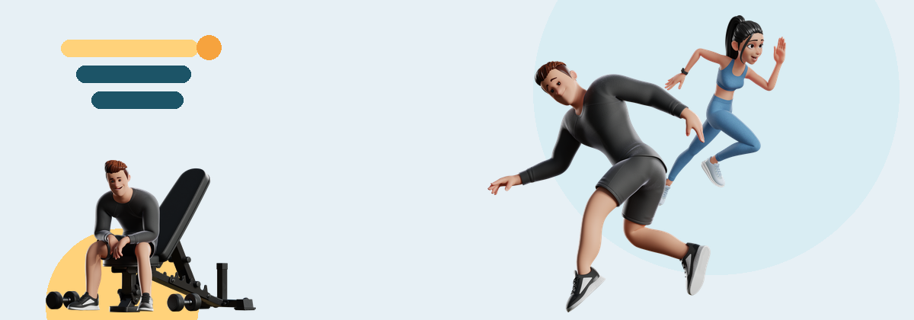
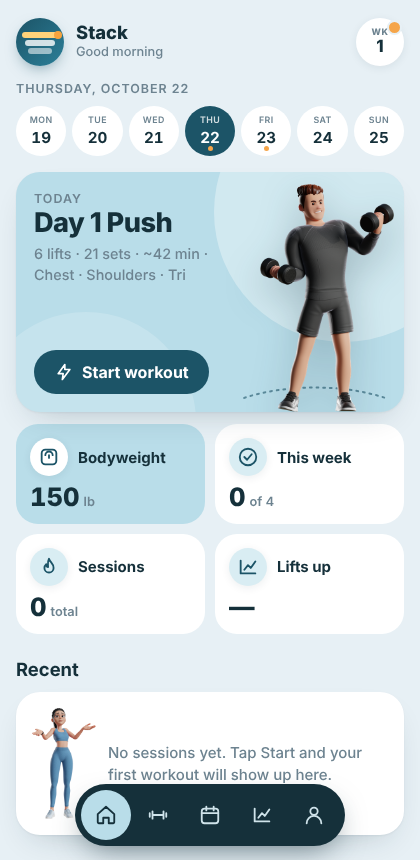
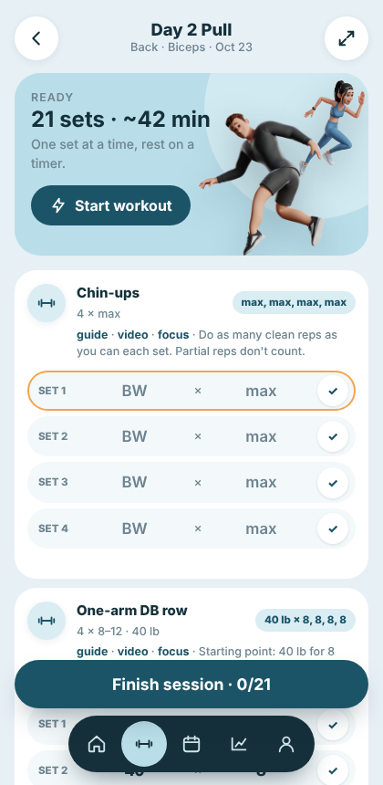
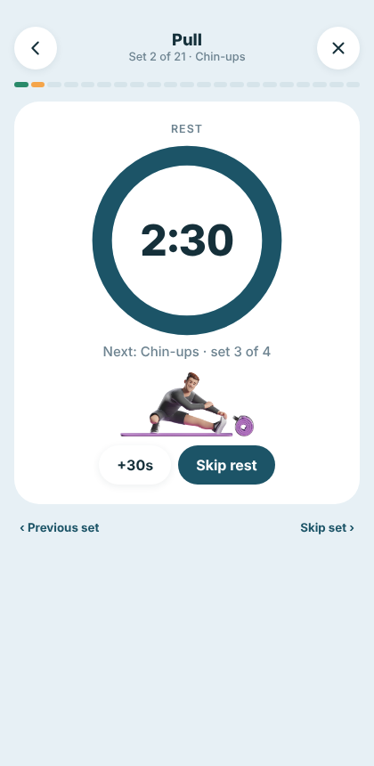
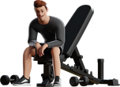
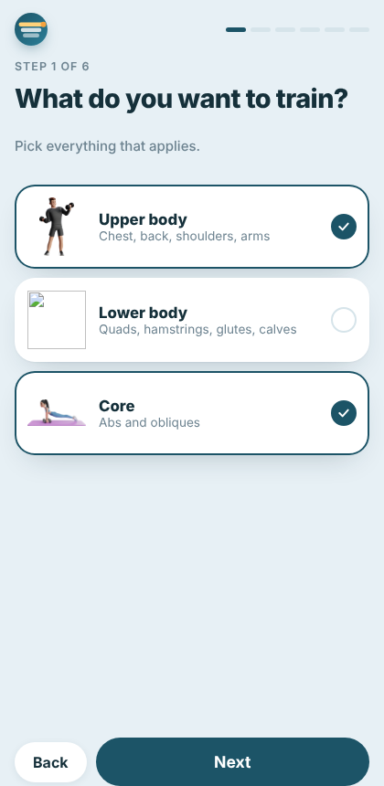
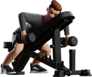

<p align="center"></p>

<h1 align="center">Stack</h1>
<p align="center"><b>Show up. Stack it up.</b><br>A home-gym training app that builds your program, logs every set, and quietly pushes the weights up for you.</p>

<p align="center">
  <a href="https://alexmattson.github.io/stack/">Open the app</a> ·
  <a href="#how-it-works">How it works</a> ·
  <a href="#the-generator">The generator</a> ·
  <a href="#progression">Progression</a> ·
  <a href="#develop">Develop</a>
</p>

---

<table>
<tr>
<td width="140" align="center"></td>
<td>

### Meet the crew

That's **Leap** on the left. He does one thing: shows up. He'll be on your home screen on training days, mid-air, waiting for you to hit Start.

The woman sprinting past him is **Dash**. She handles the sets. When you're inside a workout she's the one on the card, and when you log a set she's already on to the next one.

The guy on the bench with the towel? **Bench**. He appears on rest days. He has never once skipped a rest day and he'd like you to know it.

</td>
<td width="140" align="center"></td>
</tr>
</table>

---

## What it does

<table>
<tr>
<td width="33%" align="center"><br><sub><b>Home</b> · today's workout, the week at a glance</sub></td>
<td width="33%" align="center"><br><sub><b>Workout</b> · every lift, every set, targets pre-filled</sub></td>
<td width="33%" align="center"><br><sub><b>Focus mode</b> · one set at a time, rest on a ring</sub></td>
</tr>
</table>

- **A plan built for you**, not a template. Tell it what you want to train, how many days you have, how long a session can be, what you own, and it generates the week.
- **Per-set logging** with a rest timer that starts the moment you finish a set and tells you what's next.
- **Progression that thinks.** Hit the top of the rep range on every set and the weight goes up to the next dumbbell you actually own. Stall three sessions and it backs you off and rebuilds. Reps collapsing across sets? It tells you to rest longer.
- **Equipment-aware down to the plate.** Dumbbell pairs, kettlebell weights, bar weight and smallest plate, cable stack increments. Barbell lifts climb by two of your smallest plate; kettlebell swings jump to the next bell on your rack.
- **Frozen history.** Change your goals or gear and the plan rebuilds, but every workout you've already logged stays exactly as you did it.
- **Schedule that follows your life.** Miss a day and the rotation shifts forward; you never lose a push or pull day.
- **Progress** with weekly volume bars, a bodyweight sparkline, and first-vs-latest for every lift.
- **Installable.** Add it to your home screen; it opens full-screen with its own icon and keeps working offline.
- **Syncs** across your phone and laptop with Google sign-in, or stays device-only if you'd rather.

<table>
<tr>
<td width="140" align="center"></td>
<td>

> *"Rest days are where the muscle actually happens. I'm not lazy, I'm compounding."* — Bench

</td>
</tr>
</table>

---

## How it works

```
 Goals + schedule + equipment ──▶ program generator ──▶ this week's days
                                                              │
                     ┌────────────────────────────────────────┘
                     ▼
      Workout page ──▶ you log a set ──▶ Firestore (users/{uid}/sessions)
                                              │
                     progression engine ◀─────┘
                     (history for that lift)
                             │
                             ▼
             next session's targets: weight × reps per set
```

Everything a workout needs is decided before you start: which lifts, how many sets, the rep range, and the weight and reps to aim for on every set. You just log what happened.

### The generator

`src/lib/program.js` holds a library of ~120 movements (about 45 of them bodyweight and isometric, so the app works with no equipment at all), each tagged with muscle group, region (push / pull / legs / core), type (compound / isolation), what equipment it needs, and a starting weight for a 150 lb lifter.

Building a program (`src/lib/split.js` plans the week, `program.js` fills it with lifts):

1. **Weekly hard sets per muscle** come from the goal and your level: muscle-building ≈ 10 / 14 / 18 sets a week for new / some / experienced lifters on the big muscles, scaled down for arms, calves and core; strength runs lighter on accessories and heavier on the main lifts. Compounds credit their synergists fractionally (bench counts 0.3 of a set for triceps, rows 0.3 for biceps, hinges 0.5 for glutes), so direct arm work shrinks rather than doubling up.
2. **Each muscle is trained twice a week** (three times for strength), at most 6 / 8 / 10 direct sets a session, and never on back-to-back days when the calendar allows. The day types fall out of the day count and focus: full body at 1–3 days, upper/lower at 4, upper/lower + push/pull/legs at 5, push/pull/legs ×2 at 6 (upper/lower ×3 for strength); push/pull for an upper-only week, quad/hip days for a lower-only one. Each day type lists its muscles in session order, with A/B variants that swap the lead (squat-led vs hinge-led, press-led vs pull-led).
3. **Lifts fill the plan from what you own**: one lift per muscle, with spare slots going to the muscles with the most sets, compounds first. Barbell lifts when there's a bar and rack, floor variants when there's no bench, rows instead of chin-ups when there's no pull-up bar, bodyweight and isometric moves when there's nothing. A lift that repeats a movement pattern already in the day (a second row, a second press) scores worse, so the second slot becomes a different angle, and no two lifts of the same pattern and muscle sit back to back.
4. **Order within the session**: the day's lead muscle first, other compounds next, isolation after, calves and core last — strength gains favour whatever you do first; growth doesn't care.
5. **Rep ranges from the goal**: strength 5–8, size 8–12, endurance 12–20. Rest: 2:30 / 1:30 for size, 3:30 / 2:00 for strength, 1:00 / 0:45 for endurance; antagonist supersets go back to back with the full rest after the pair.
6. **Starting weights** scale with bodyweight and experience, then snap to weights you actually have.
7. **Emphasis, not toggles.** Each area (upper, lower, core) has a 0–5 level. Normal is a full share of the week; A little or Some rides along as a finisher on the main days ("throw a little legs in"); More and Max add sets within the weekly ceiling.
8. **Variety week to week.** The rep scheme rotates through the cycle (size: 8–12 → 6–10 → 10–15), the A/B lead swaps every other week (squat-led then hinge-led, press-led then pull-led), and lifts that score close to each other shuffle by week so you don't repeat the same session four times. For strength the first compound of each day stays fixed, since strength is partly practice.

The model follows the research summary in `docs/` terms: at equal weekly volume, frequency and split type don't change growth (Schoenfeld 2019; Ramos-Campo 2024), strength favours more frequent practice and the exercises done first in a session (Pelland 2026; Nunes 2021), ≥10 sets a muscle a week with diminishing returns past ~20 (ACSM 2026; Baz-Valle 2022), 48–72 h between hard sessions for a muscle, and antagonist supersets preserving reps while same-muscle supersets don't (Zhang 2025).

Turn any exercise off on the Exercises page and the next-best option takes its slot.

### Progression

`src/lib/progression.js` reads every past session of a lift, newest first, and returns a target for each set plus a one-line reason.

| What happened last time | What you get |
|---|---|
| First time on the lift | Starting weight at the bottom of the range |
| Top of the range on every set | Next weight you own, reps reset to the bottom (two steps if you rated it all Easy) |
| Otherwise, set by set | Easy → +2 reps, Hard → +1, Max → hold; a set that missed its target holds too |
| Under the bottom of the range on two sets | Drop one weight step and rebuild |

Inside a session the targets move too: miss a set by 3+ reps and the next set drops a weight step with reps back to the bottom of the range; miss by 1–2 and the next set asks for what you just got. The next session then starts from the weight most of your sets were done at.
| Reps fell 4+ from set one to the last set | Same targets, rest 2–3 minutes |
| Three sessions at one weight, no rep gain | Drop one step, own the top of the range, climb back |
| Maxed out your heaviest weight | Add reps, slow the lowering, buy heavier |
| Chin-ups / pull-ups | +1 rep on set one; at 40 total reps, add a dumbbell |

Rest between sets: 2:30 after compounds, 1:30 after isolation and core work, 2:00 after the last set of a lift, 0:30 inside a superset.

### Warm-up cadence

Focus mode opens with two or three warm-up moves, one card each with a guide link, picked per muscle region from a warm-up library and filtered by your equipment (easy push-ups and pike push-ups on a push day, a dead hang or band pull-aparts on a pull day, bodyweight squats and glute bridges on a leg day). Ramp sets then sit right before the lift they belong to: the first compound of the session gets the full ramp (50% × 8, 70% × 5, 85% × 2), the first lift of each *new* movement pattern gets a single feel set (70% × 4), and a lift that repeats a pattern already trained that day (a second press, a second row) gets none. The generator also keeps any one pattern to at most two lifts per day, so you never spend half a session on variations of the same row.

<table>
<tr>
<td width="140" align="center"></td>
<td>

> *"All sets logged. Eat, sleep, grow."* — the green card you'll see when you're done

</td>
</tr>
</table>

---

## Onboarding

<table>
<tr>
<td width="33%"></td>
<td>

First launch walks you through six questions and shows the plan it built before you commit:

1. What do you want to train? (upper / lower / core)
2. What's the goal? (build muscle / get strong / tone & condition)
3. Which days can you train?
4. Session length, experience, bodyweight
5. What do you have? (with weights for anything that needs them)
6. Your plan is ready

Admins can replay it from the Account page to test changes.

</td>
</tr>
</table>

---

## Develop

```bash
npm install
npm run dev                 # local dev server
npm test                    # generator + progression unit tests
npm run build               # production build to dist/
VITE_MOCK=1 npm run build   # build against the in-memory Firebase mock (used by the e2e harness)
```

### Structure

```
src/
  lib/
    program.js      exercise library, equipment ladders, program generator   (pure)
    progression.js  per-lift targets, strength summary                      (pure)
    plan.js         calendar projection from the log                         (pure)
    dates.js        date helpers
    firebase.js     auth + per-user Firestore API (users/{uid}/…)
    firebase.mock.js in-memory stand-in for tests
  hooks/
    useAuth.js      loading → login → ready; Google / anonymous; admin flag
    useData.js      live sessions, bodylog, settings; all writes
    useWorkout.js   one workout's frozen plan, cursor, suggestions
    useRestTimer.js countdown
  components/
    ui.jsx          Card, Pill, PageHeader, BigInput, Segmented, Toggle, Ring, icons, logo
    NavRail.jsx, Splash.jsx
  pages/
    LoginScreen, Onboarding, HomePage, WorkoutPage, FocusMode,
    SchedulePage, ProgressPage, SetupPage (Goals + Equipment), ExercisesPage, AccountPage
  styles.css        design tokens + component styles
tests/              node:test unit tests
.github/workflows/  build + deploy to GitHub Pages
firestore.rules     each user reads/writes only users/{uid}/**
```

### Data model

```
users/{uid}
  isAdmin: bool                      (optional)
  settings/program                   focus[], emphasis{upper,lower,core: 0–5}, goal, length, experience, bodyweight, excluded[]
  settings/equipment                 dumbbells[], bench, equipment[], kettlebells[], barbell{}, ezbar{}, cable{}, bands[]
  settings/schedule                  trainingDays[]
  sessions/{date}_{dayKey}           date, day, plan[] (frozen), sets{key:[{w,r,e?,t?}]} (e = effort 1–3, t = target reps), note, savedAt
  bodylog/{date}                     weight, arm
```

### Deploy

Push to `main`. The workflow builds with Vite and publishes `dist/` to GitHub Pages. Firebase config lives in `src/lib/firebase.js`; the site's domain must be in Firebase → Authentication → Authorized domains, and `firestore.rules` pasted into Firestore → Rules.

<table>
<tr>
<td width="140" align="center"></td>
<td>

> *"The plan only uses what you own. No, you can't do lat pulldowns on a resistance band. Yes, I've been asked."* — the Equipment page

</td>
</tr>
</table>

---

<p align="center"><sub>Character illustrations from a licensed 3D pack. Built with React, Vite and Firebase.</sub></p>
